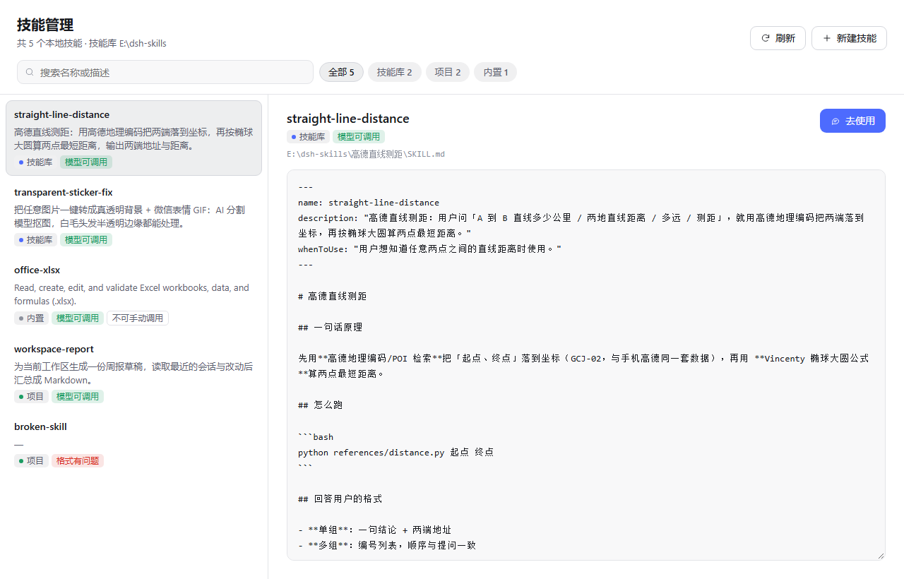
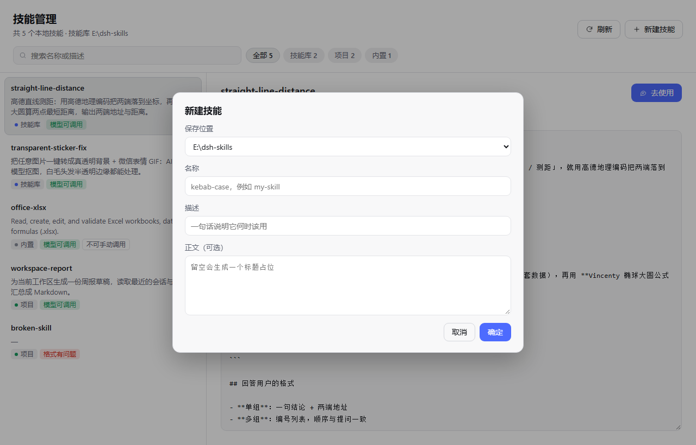

# dsh-skill-manager · 技能管理

DeepSeek Harness（DSH）Web GUI 的**技能管理**插件：侧边栏在「插件」下面多一行「技能管理」，点开是一个技能面板——列出磁盘上的全部本地技能，只读查看 `SKILL.md` 全文，并一键用选中的技能开一个新对话。





> 预览为独立渲染（同一份 `lib/client.js` + 近似浅色主题 token），非运行中应用截图。

## 功能

- **侧边栏入口**：注册在 `sidebar.panellist`，order 5，排在「插件」(0) 与「自动化任务」(10) 之间；面板本身是同一个 id 的 `main` keyed slot。
- **技能目录**：按 `dsh-skill-filesystem` 的优先级扫描本地根目录：

  | rank | 来源 | 路径 |
  |---|---|---|
  | 100 | 项目 | `<workspace>/.dsh/skills` |
  | 200 | 项目 | `<workspace>/.agents/skills` |
  | 400 | 技能库 | `E:\dsh-skills`（`DSH_SKILL_LIBRARY_DIR` 可覆盖） |
  | 500 | 共享 | `~/.agents/skills` |
  | 600 | 内置 | `$DSH_BUNDLED_SKILL_DIR` / `<app>/resources/runtime/office-skills` |

  每个根目录下的 `<name>/SKILL.md` 与平铺的 `<name>.md` 都会被解析；同名技能先到先得，被覆盖的数量会在列表底部提示。
- **只读查看**：右侧展示 `SKILL.md` 原文，可选中、可滚动；不写盘，技能内容统一通过对话让 AI 修改。
- **去使用**：详情页右上角，绑定当前技能。用户可调用的技能会把 `/技能名 ` 预填进新对话草稿；模型专用技能只开一个空白新对话。底层是 `uiWorkspace.startSession()`，与侧边栏「新建会话」同一条路径。
- **新建**：用表单在技能库或项目目录下生成一个空技能骨架。
- **筛选**：按名称/描述搜索，按来源切 chip；切换 chip 时右侧详情会跟着切到该组第一个技能。
- **标签配色**：来源用圆点区分（技能库蓝、项目绿、内置灰、共享灰），能力用底色区分（模型可调用绿、不进模型目录橙、不可手动调用描边、格式有问题红）。

## 技能存放在哪里

默认技能库是 `E:\dsh-skills`（可用环境变量 `DSH_SKILL_LIBRARY_DIR` 改）。DSH 的本地发现只认 `<dshHome>/skills`，所以想让 DSH 直接发现技能库，把用户技能目录做成指向它的目录联接即可（Windows）：

```powershell
New-Item -ItemType Junction -Path "$HOME\.dsh\skills" -Target 'E:\dsh-skills'
```

- 文件只在技能库存在一份，`~/.dsh/skills` 只是一个入口；
- 面板识别到两者是同一个真实目录后，会把技能库当作 400 级根目录（primary），并作为新建技能的默认位置；
- 若没有这个联接，面板会退回 `~/.dsh/skills` 作为默认位置，避免把技能写到模型目录看不到的地方。

## 组成

两个半侧，零外部依赖：

- `lib/index.js` — Node 半侧。通过 `ctx.webServer` 注册六个仅回环可用的 `/api/dsh-skill-manager/*` 路由，负责扫描、解析 frontmatter、读取，以及表单新建时写盘。
- `lib/client.js` — 浏览器半侧。预构建的 `window.__ModuleLoader__` 模块，只 `require` 基座里的 `react`，注册侧边栏行与主面板。

浏览器传来的路径都会与已扫描的根目录比对，只允许操作根目录内的 `.md` 文件。

## 安装

包内 `cordis.patch.yml` 声明了自己的 bundle 行，可直接作为 bundle 安装：

```
plugin_manager install_bundle  https://github.com/EvilHunter01/dsh-skill-manager
```

本机目录安装也可以：`plugin_manager install_bundle E:\path\to\dsh-skill-manager`。

手动方式：把包加进 profile 的 `package.json` 依赖与 `dsh.profile.bundles`，再在 `cordis.patch.yml` 插入

```yaml
- insert:
    - id: skill-manager
      name: 'dsh-skill-manager'
```

## 验证

```
GET /api/dsh-skill-manager/list
```

返回 `{ roots, skills, library, scannedAt }`；root 带 `id/kind/rank/path/displayPath/writable/exists/primary`，skill 带 `name`、`description`、`path`、`source`、`modelInvocable`、`userInvocable`、`valid`、`problem`、`bytes`、`mtimeMs`。

`node test-host.mjs` 用假 Cordis 上下文离线驱动全部路由。

## 已知限制

- 只列磁盘上的技能；插件用 `ctx.skills.register(...)` 注册的内存技能没有可编辑文件，不会出现。
- 面板不写技能正文；`/save`、`/remove`、`/reveal` 三个路由仍保留（回环可用、路径受根目录限制），留给以后可能的编辑界面。
- 项目根目录来自 profile 已记录的 workspace，未打开过的目录不会扫描。

## License

MIT
